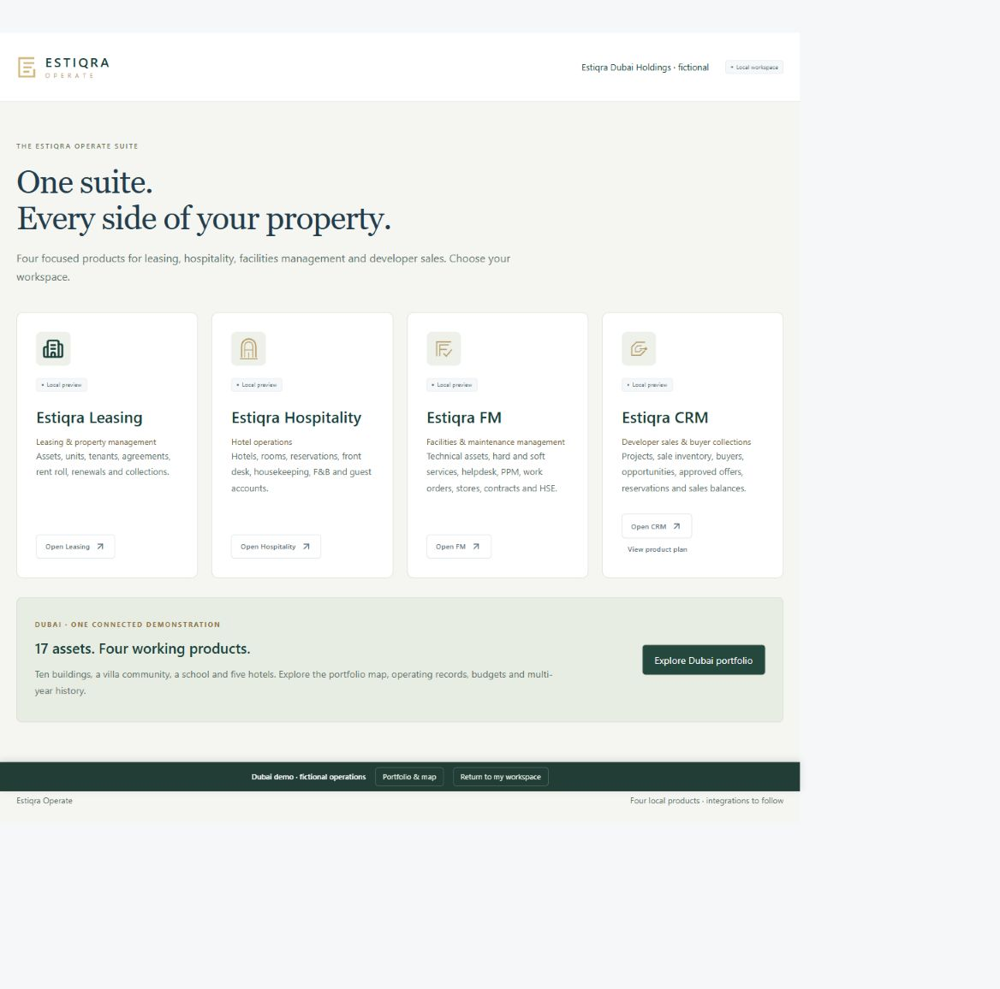
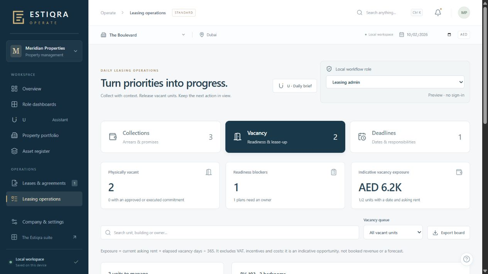
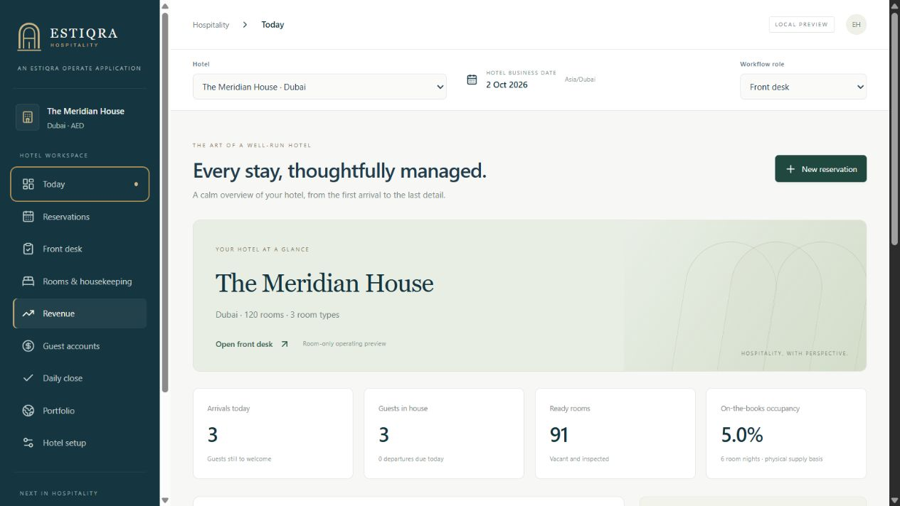
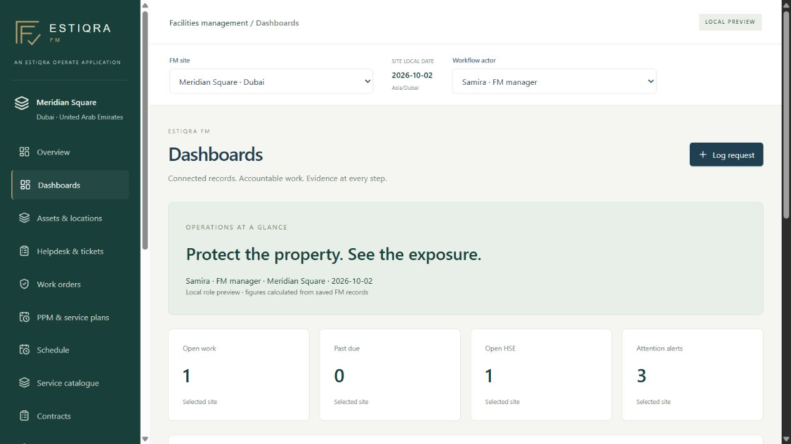
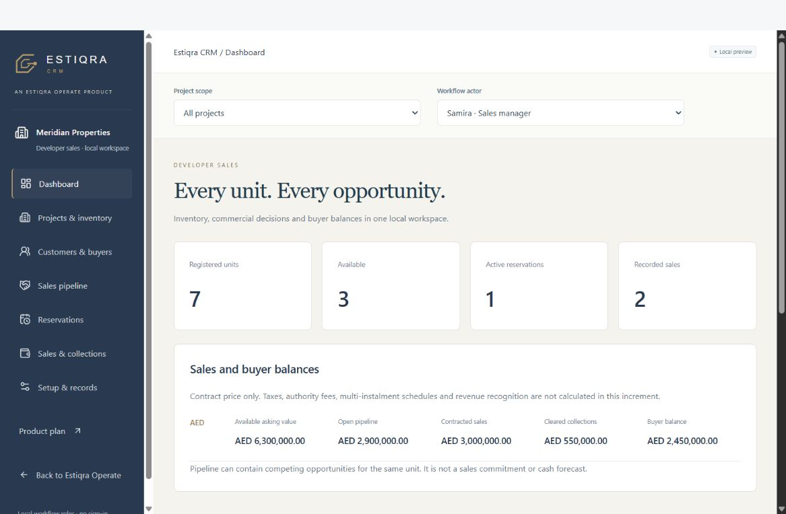

# Estiqra Operate

### One suite for the operational side of property.

**Leasing, hospitality, facilities management, and developer sales in four focused product workspaces.**

[Founder](https://github.com/mosaradwan-star) · [Estiqra intelligence showcase](https://github.com/mosaradwan-star/estiqra-showcase) · [Product enquiries](https://www.estiqra.com/#contact)

**Current stage:** a working local prototype. The screenshots show fictional demonstration records, not customer data, traction, or actual property performance. Production deployment and connected services are further development work.

*The suite entry screen. Its Dubai portfolio scenario uses fictional ownership and operations.*

## The problem

Property teams manage a connected business through separate operational workflows: leases and rent, hotel stays, maintenance, and property sales. Each team needs a focused workspace, while the owner needs a clear view of the work and the decisions that require review.

## The product

Estiqra Operate brings four peer products into one suite. Each workspace follows the records and decisions of its domain, with linked operational context and explicit review steps.

| Product | Working prototype scope |
| --- | --- |
| **Estiqra Leasing** | Property and unit registers, lease preparation, agreement drafts, rent roll, billing, collections, renewals, and leasing priorities. |
| **Estiqra Hospitality** | Hotel and room setup, reservations, front desk, housekeeping, guest accounts, food-and-beverage operations, and daily closing. |
| **Estiqra FM** | Sites and equipment, service requests, work orders, planned maintenance, hard and soft services, operational dashboards, and completion review. |
| **Estiqra CRM** | Developer sales inventory, buyer profiles, opportunities, approved offers, reservations, recorded sale references, collections, and buyer balances. |

## Inside the products

### Leasing: turn operational priorities into action

The leasing workspace keeps collections, vacant-unit readiness, and upcoming deadlines visible. Property and unit records connect to agreements, billing, renewals, and operational follow-up.

*Fictional demonstration portfolio. Amounts and operating metrics are examples.*

### Hospitality: manage the stay from arrival to close

The hotel workspace brings reservations, front-desk activity, housekeeping, guest accounts, and daily closing into a focused hotel operating view.

*Fictional hotel and demonstration room metrics.*

### Facilities management: make work accountable

The FM workspace connects sites, equipment, helpdesk requests, scheduled maintenance, work execution, and completion review. Dashboards keep open work and attention queues in view.

*Fictional site, workflow actor, and operational records.*

### CRM: connect inventory, opportunities, and buyer balances

The developer-sales workspace follows a unit from available inventory through an opportunity, reviewed offer, reservation, and recorded sale. It keeps cleared collections and outstanding buyer balances distinct.

*Fictional developer-sales scenario. Financial figures illustrate the workflow and are not revenue or traction claims.*

## Who it is for

- Property owners and leasing teams managing portfolios and tenant operations.
- Hotel operators coordinating reservations, rooms, housekeeping, and guest accounts.
- Facilities teams planning maintenance and following work through completion.
- Developers coordinating inventory, sales opportunities, reservations, and collections.

## Product direction

Estiqra focuses on evidence-led real estate analysis. Estiqra Operate focuses on day-to-day property operations. The product direction is to connect intelligence with operational work, beginning with a Dubai demonstration and extending across markets.

The current prototype demonstrates workflows and review routing. Secure multi-user production services, live integrations, and connected AI services remain future work; they are not represented as launched features here.

## About this showcase

This repository contains a product overview and five inspected demonstration screenshots. Estiqra Operate's application source, internal documentation, credentials, private datasets, and customer files remain private.

Founded by **Rdwan Mousa**. [Visit the founder's portfolio](https://github.com/mosaradwan-star) or [contact Estiqra](https://www.estiqra.com/#contact) for product conversations.

© 2026 Estiqra. All rights reserved. This showcase does not grant rights to the proprietary application source or brand assets.
